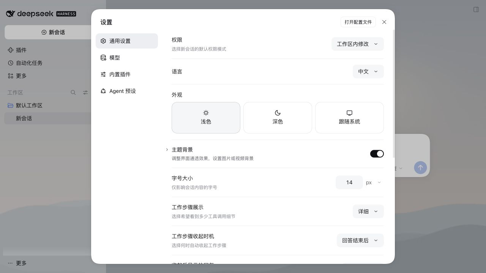
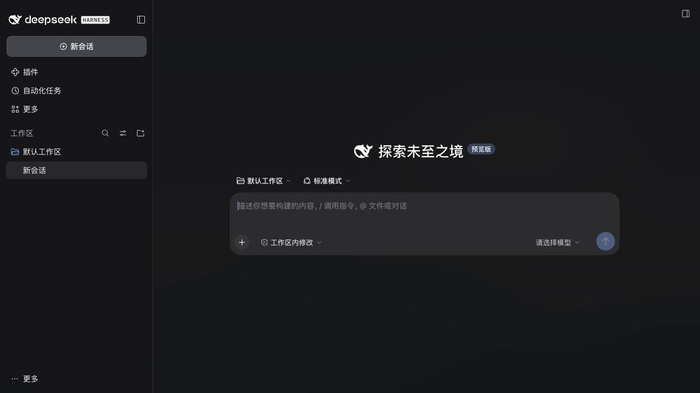
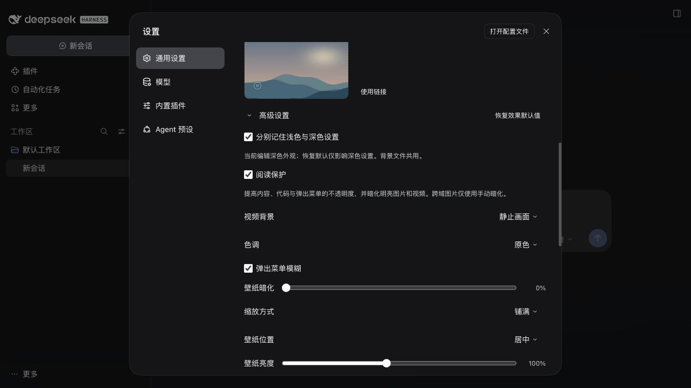

<div align="center">

<h1>Liquid Glass</h1>
<p><strong>Translucent surfaces and custom backgrounds for DeepSeek Harness.</strong></p>
<p><code>dsh-liquid-glass</code></p>

<p><a href="README.md">简体中文</a> · <strong>English</strong> · <a href="README.ja.md">日本語</a> · <a href="README.es.md">Español</a> · <a href="README.fr.md">Français</a> · <a href="README.de.md">Deutsch</a> · <a href="README.ru.md">Русский</a> · <a href="README.pt-BR.md">Português (Brasil)</a></p>
<p><a href="CHANGELOG.md">Changelog</a> · <a href="LICENSE">MIT License</a></p>

<p>
  <a href="https://www.npmjs.com/package/dsh-liquid-glass"></a>
  <a href="https://www.npmjs.com/package/dsh-liquid-glass"></a>
  <a href="https://github.com/Ultroncn/dsh-liquid-glass/actions/workflows/ci.yml"></a>
  <a href="docs/v0.4.0-validation.md"></a>
  <a href="LICENSE"></a>
  <a href="https://dsh-insights.com/p/Ultroncn/dsh-liquid-glass/"></a>
</p>

<p><a href="https://awesome-dsh-plugin.com/p/Ultroncn/dsh-liquid-glass/">Plugin market</a> · <a href="https://www.npmjs.com/package/dsh-liquid-glass">npm</a> · <a href="https://github.com/Ultroncn/dsh-liquid-glass/releases">Releases</a> · <a href="https://github.com/Ultroncn/dsh-liquid-glass/issues">Issues</a></p>

</div>

Liquid Glass adds adjustable glass surfaces and image or video backgrounds to [DeepSeek Harness](https://github.com/deepseek-ai/deepseek-harness) (DSH). It is maintained by the community.

> **Version 0.6.0** puts wallpaper rotation inside Background. Add several images, replace them individually, and browse up to six thumbnails in a single scrollable row. See the [changelog](CHANGELOG.md) for the removal of appearance import and export and the rest of the release.

## Install and open

Search for `dsh-liquid-glass` in the DSH plugin market and check the author **Ultroncn**. In the app’s **Add plugin** field, enter `dsh-liquid-glass@0.6.0`.

For the CLI, use the profile your DSH instance runs under. The examples use `web`.

```sh
dsh plugin --profile web add dsh-liquid-glass@0.6.0 --registry=https://registry.npmjs.org/
```

Restart DSH after installing or updating. Open **Settings → General → Theme background**, just below **Appearance**, and expand the row. The switch applies the glass and background effects together and retains your preferences.

Run the same command to upgrade to 0.6.0. It pins the version and uses the official npm registry. If pnpm reports `ERR_PNPM_ADDING_TO_ROOT`, add `-w` after `add`.

## Use Liquid Glass

1. Choose **Regular**, **Clear**, or **Frost**, then fine-tune the surface transparency (3%–95%). Selecting a preset previews it. **Apply preset** saves it, **Cancel preview** restores the saved look, and **Undo preset change** restores the previous appearance during the current session.
2. Under **Background**, add a local image, an image URL, or a local MP4/WebM video up to 100 MiB. Video decoding depends on your browser. Preview the background, then select **Save** for the main background picker. Videos loop muted and can be paused.
3. **Add images** in **Background** selects several photos at once. Click a thumbnail to use it, or replace it in place. Open **Rotation settings** to change the order and timing. Rotation is evaluated when DSH opens. **Recent images** retains up to 12 saved images and their composition. **Adjust wallpaper composition** supports dragging, wheel zoom, and keyboard-accessible sliders, with a save or cancel step.
4. Open **Advanced settings** for separate light and dark appearances, reading protection, tint, menu frost, fit, position, brightness, and dimming. Saved videos can use a still frame. Resetting the effects preserves the background and the main switch.

Turn off **Glass surfaces** to keep the background with the host’s native surfaces. **Restore native appearance** asks for confirmation, then clears the active background and restores appearance defaults while retaining the saved rotation gallery.

**Wallpaper opacity** fades the image or video. **Menu glass blur** only affects the supported menu and material preview filters.

Reading protection is on by default. It keeps dialogs and overlays opaque and content, code, and menus at least 94% opaque while leaving the base and sidebar adjustable. It also dims bright local or same-origin media. Cross-origin images are excluded from automatic sampling. Advanced settings provides independent automatic dim and vignette controls and an [estimated content contrast readout](docs/reading-protection-contrast.md). Increased contrast temporarily selects Frost and caps transparency at 50%.

Use **Ctrl/Cmd+Shift+G** to toggle the effects, or find **Toggle Liquid Glass** in DSH’s keyboard-shortcut settings. Linux Web and conflicting defaults start without a binding.

## Screenshots

These screenshots show the 0.4.0 interface in DSH 0.2.2-rc.2 Web.


<details>
<summary>More screenshots</summary>





</details>

## Compatibility and data

The client bundle targets DSH Web. Validation includes [DSH 0.2.2-rc.2](docs/v0.4.0-validation.md), the published release checks in the [changelog](CHANGELOG.md), and the Web checks for the [gallery update](https://github.com/Ultroncn/dsh-liquid-glass/pull/30). See the [host API notes](docs/v0.2.0-local-evidence.md) for integration details. The plugin interface provides English and Simplified Chinese. **Advanced settings → Diagnostics and compatibility** shows the verified host version, test date and live hook status. Its copyable JSON report includes capability and appearance status. With the system’s reduced transparency preference enabled, the plugin uses opaque surfaces and hides wallpaper until the preference is cleared.

Preferences and images are stored in the site’s `localStorage`. Videos and the recent image history are stored in IndexedDB. The plugin has no server component or telemetry.

To uninstall, run `dsh plugin --profile web remove dsh-liquid-glass` with the same profile. Remove saved backgrounds before uninstalling if you want to free the media storage. Uninstalling retains the site’s local records.

## Verify from source

```sh
npm ci
npm test
npm pack --dry-run --json
```

The smoke tests exercise the client bundle in a mocked DSH Web runtime. GitHub CI uses Node.js 24.
