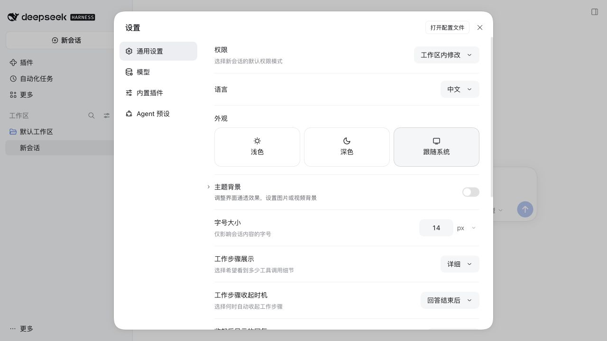
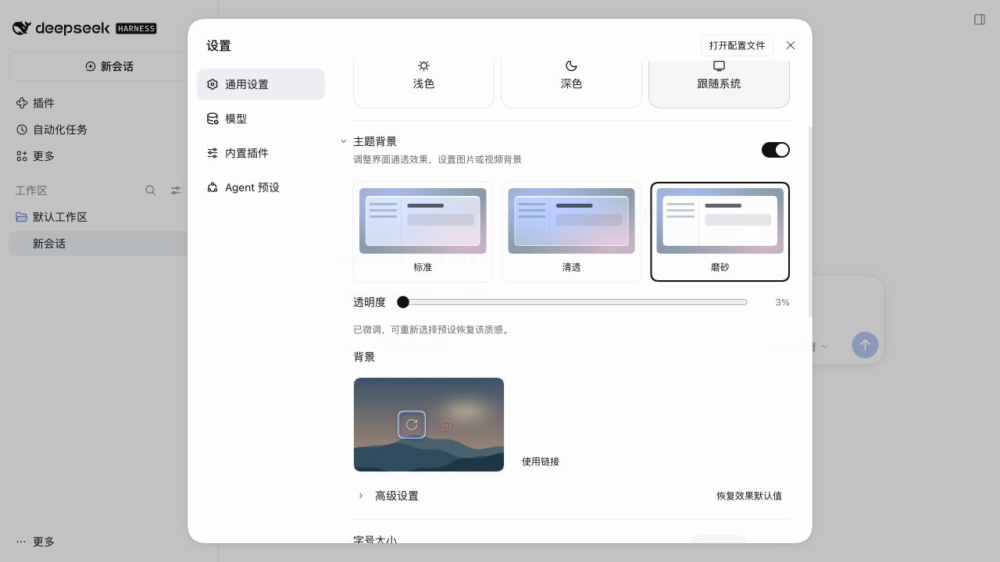
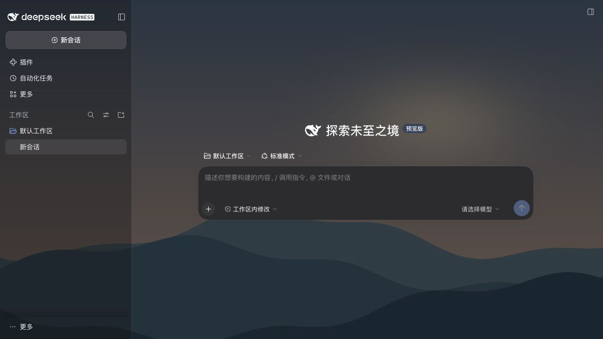
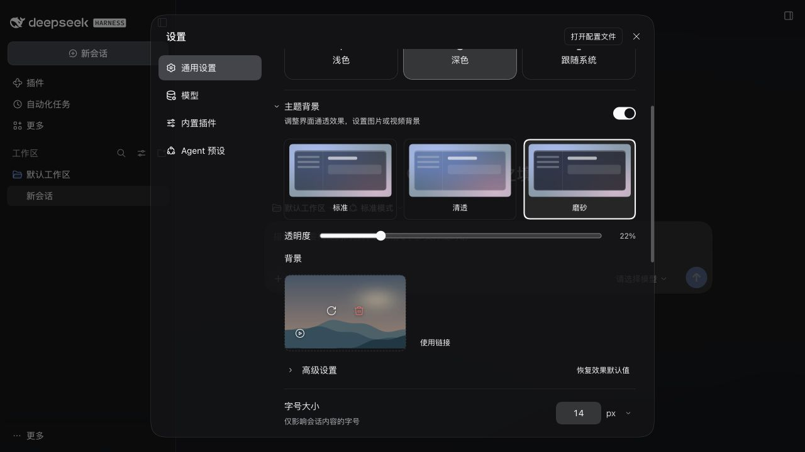

# dsh-liquid-glass

English | [中文](README.zh.md)

[](https://www.npmjs.com/package/dsh-liquid-glass)
[](LICENSE)
[](https://github.com/deepseek-ai/deepseek-harness)

**Theme backgrounds for [DeepSeek Harness](https://github.com/deepseek-ai/deepseek-harness)** — translucent surfaces with image or local video backgrounds.

Translucent theme surfaces and scoped frosted menus over your own background image, with material presets, tint, wallpaper controls, and system accessibility response. Current version: **0.3.0**. A community plugin that reuses the host’s official controls where available.

## Install

```sh
dsh plugin --profile web add dsh-liquid-glass
```

Run the command in a terminal. In the app’s Add plugin field, enter only `dsh-liquid-glass`.

Open **Settings → General → Theme background**, immediately below Appearance. Expand the official chevron for basic options; advanced options remain collapsed. The switch controls glass and image/video backgrounds together, retaining preferences when disabled. Restart the host after upgrading. Enter `dsh-liquid-glass@0.3.0` in the app’s plugin field, not the full terminal command.

## Screenshots

Captured from the actual package in official DSH 0.2.2-rc.2 Web, using original local demonstration media. The light settings view uses 3% transparency; the dark background view uses the Clear preset.









## What you get

- **Host controls**: reuse Switch, Button, Input, Checkbox, Menu, Modal and chevron icons. No public settings-row or slider component exists; a small layout adapter handles these without private CSS classes.
- **Local video backgrounds**: select MP4/WebM up to 100 MiB, with a browser-supported codec. Validated files preview immediately and are saved locally only after Save; playback loops muted; pause, resume and removal are available. Hidden pages and reduced-motion preferences pause playback. No video URLs, audio or playlists.
- **Visual cards**: three material previews and one permanent image/video uploader, with click or drag-and-drop selection. Replace and red remove controls sit over the thumbnail; no separate filename or media-description row.
- **Background drafts**: add, replace or remove to preview immediately; Save commits the selection. Closing settings, switching menus or collapsing the section prompts Save and leave, Discard changes or Keep editing. Discard restores the saved background.
- **Compact defaults**: presets, transparency and background selection; tint, frost, fit and reading protection live under Advanced. Reset preserves the background and master switch.

- **Theme surface transparency** through the official ThemeRuntime tokens, with a 3%–95% transparency slider.
- **Regular, Clear, and Frost presets**, plus cool white, warm gray, and ink tints. Manual transparency fine-tunes the selected preset.
- **Scoped menu frost** with an independent switch, a settings-card rim color, and a material preview with an inset highlight. Host filter placement stays unchanged.
- **Wallpaper controls**: cover/contain/fill, nine positions, brightness 20%–200%, and manual dim 0%–60%. With reading protection enabled, videos and bright local or same-origin images receive at least 35% dim; cross-origin links use manual dim only. Large static uploads are compressed; GIF data is preserved.
- **System accessibility response**: reduced transparency or increased contrast selects effective Frost material and limits transparency to 50%, without overwriting saved preferences.
- **Keyboard toggle**: Ctrl/Cmd+Shift+G through the host shortcut service. Change or remove “Toggle Liquid Glass” in the host Keyboard shortcuts settings. Linux Web starts unbound; conflicting defaults fall back to an unbound command.

Independent user/assistant opacity floors and general host-panel blur/highlights are not implemented: verified official extension hooks are missing. See [local API evidence and validation limits](docs/v0.2.0-local-evidence.md). See [theme background validation](docs/theme-background-validation.md) for this change.

## Privacy and compatibility

The host has no public settings leave-guard API. Unsaved-change protection uses a small adapter for the 0.2.2-rc.2 settings structure and needs regression checks after host updates.

- Preferences and images use origin-local `localStorage`; video Blobs use IndexedDB. Media is not shared across browsers or origins, and clearing site data deletes saved videos; the plugin has no server component and sends no telemetry.
- The UI integrates through DeepSeek Harness's public client runtime, locale, slot, theme, and shortcut APIs. Shortcut bindings use host-managed device-local storage (localStorage on Web; keybindings.json on Desktop).
- Light and dark color schemes are supported. A DSH restart is required once after installation so the client bundle can be loaded.

## Verify from source

The smoke test runs the published client bundle inside a mocked DSH browser runtime and exercises registration, lifecycle, settings, persistence, wallpaper controls and slider bounds:

```sh
node test/smoke.test.mjs
```

## Uninstall

```sh
dsh plugin --profile web remove dsh-liquid-glass
```

Remove the background in settings before uninstalling if desired. Uninstalling does not automatically clear localStorage or IndexedDB; saved videos still consume local storage. Do not erase all host site data just to clean this plugin.

## License

MIT
