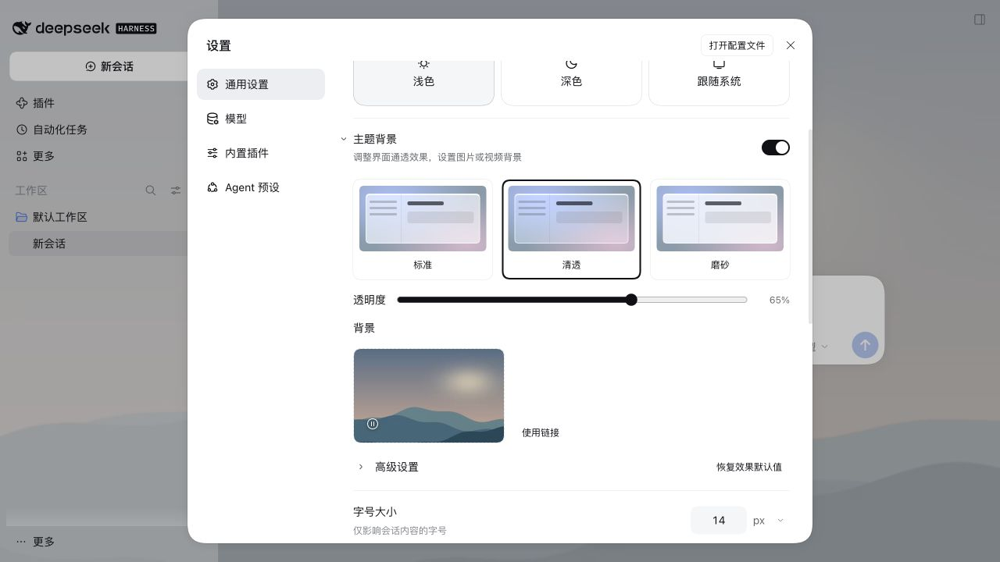

<div align="center">

<h1>Liquid Glass</h1>
<p><strong>Superfícies translúcidas e fundos personalizados para DeepSeek Harness.</strong></p>
<p><code>dsh-liquid-glass</code></p>

<p><a href="README.zh.md">简体中文</a> · <a href="README.md">English</a> · <a href="README.ja.md">日本語</a> · <a href="README.es.md">Español</a> · <a href="README.fr.md">Français</a> · <a href="README.de.md">Deutsch</a> · <a href="README.ru.md">Русский</a> · <strong>Português (Brasil)</strong></p>
<p><a href="CHANGELOG.md">Histórico de alterações</a> · <a href="LICENSE">Licença MIT</a></p>

<p>
  <a href="https://www.npmjs.com/package/dsh-liquid-glass"></a>
  <a href="https://www.npmjs.com/package/dsh-liquid-glass"></a>
  <a href="https://github.com/Ultroncn/dsh-liquid-glass/actions/workflows/ci.yml"></a>
  <a href="docs/v0.4.0-validation.md"></a>
  <a href="LICENSE"></a>
  <a href="https://dsh-insights.com/p/Ultroncn/dsh-liquid-glass/"></a>
</p>

<p><a href="https://awesome-dsh-plugin.com/p/Ultroncn/dsh-liquid-glass/">Catálogo de plugins</a> · <a href="https://www.npmjs.com/package/dsh-liquid-glass">npm</a> · <a href="https://github.com/Ultroncn/dsh-liquid-glass/releases">Versões</a> · <a href="https://github.com/Ultroncn/dsh-liquid-glass/issues">Relatar problemas</a></p>

</div>

O Liquid Glass adiciona superfícies translúcidas e fundos com imagens ou vídeos ao [DeepSeek Harness](https://github.com/deepseek-ai/deepseek-harness) (DSH). É um plugin mantido pela comunidade.

> **Versão 0.5.0 publicada no npm:** inclui a lista de rotação original e a importação e exportação de configurações de aparência em JSON. As [mudanças na branch main](https://github.com/Ultroncn/dsh-liquid-glass/pull/30) levam a rotação para a seção de fundos, com até seis miniaturas em uma única linha com rolagem horizontal. A importação e a exportação de aparência foram removidas. Essas mudanças ainda aguardam publicação no npm.

## Instalação e acesso

Procure por `dsh-liquid-glass` no catálogo de plugins do DSH e confira se o autor é **Ultroncn**. No campo de adição de plugins do aplicativo, digite `dsh-liquid-glass@0.5.0`. Ao usar o terminal, substitua `web` pelo perfil em que você executa o DSH.

```sh
dsh plugin --profile web add dsh-liquid-glass@0.5.0 --registry=https://registry.npmjs.org/
```

Reinicie o DSH após instalar ou atualizar. Abra **Settings → General → Theme background** (**设置 → 通用 → 主题背景**), logo abaixo de **Appearance**. O interruptor principal controla o efeito de vidro e o fundo em conjunto. Suas preferências ficam salvas ao desativá-lo.

Para atualizar para 0.5.0, execute o mesmo comando. Ele especifica a versão e usa o registro oficial do npm. Se aparecer `ERR_PNPM_ADDING_TO_ROOT`, adicione `-w` depois de `add`.

## Como usar

1. Escolha **Regular**, **Clear** ou **Frost** e ajuste a transparência da interface entre 3% e 95%.
2. Em **Background**, escolha uma imagem local, um link de imagem ou um vídeo local MP4/WebM de até 100 MiB. O navegador precisa oferecer suporte ao codec. No seletor de fundo principal, confira a prévia e clique em **Save**. Os vídeos se repetem sem som e podem ser pausados.
3. Na versão 0.5.0, adicione o fundo salvo à lista **Wallpaper rotation**. A rotação vem desativada e, quando ativada, a troca é avaliada ao abrir o DSH. Na branch main, use **Add images** para escolher várias imagens e clique em uma miniatura para aplicar o fundo. Use o botão de substituição para trocar uma imagem específica.
4. Abra **Advanced settings** para configurar separadamente os modos claro e escuro e ajustar a proteção de leitura, a tonalidade, o desfoque dos menus, o enquadramento, a posição, o brilho e o escurecimento. Você também pode exibir um quadro estático do vídeo.

## Captura de tela

Interface da versão 0.4.0 no DSH 0.2.2-rc.2 Web.



## Compatibilidade e dados

O plugin é voltado para o DSH Web. A interface está disponível em inglês e chinês simplificado. Consulte os [resultados de validação](docs/v0.4.0-validation.md) e o [histórico de alterações](CHANGELOG.md).

As preferências e imagens ficam no `localStorage` do site. Os vídeos ficam no IndexedDB. O plugin funciona sem servidor próprio nem telemetria. Para desinstalar, execute `dsh plugin --profile web remove dsh-liquid-glass` com o mesmo perfil. Para liberar o armazenamento, remova os fundos salvos nas configurações antes de desinstalar.
