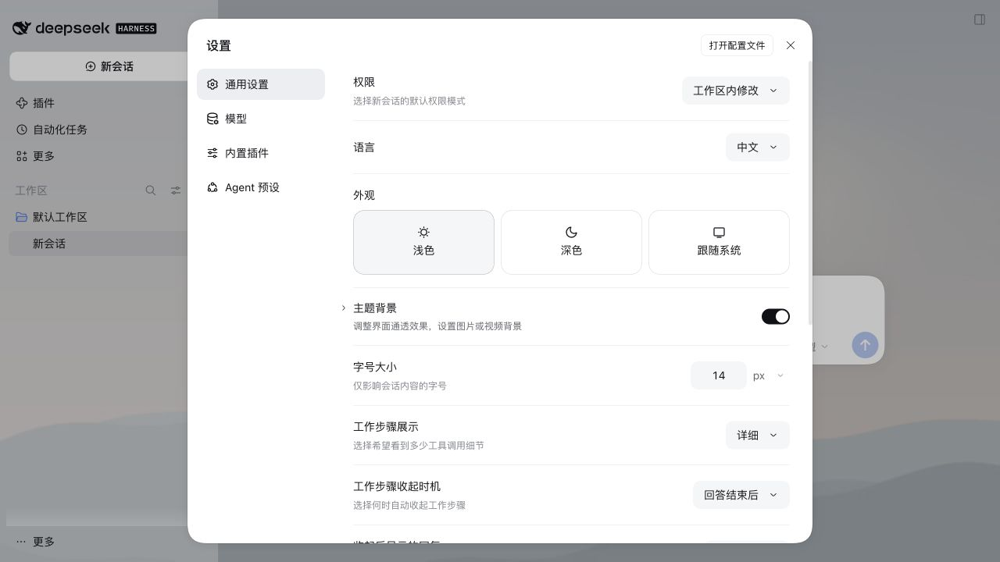
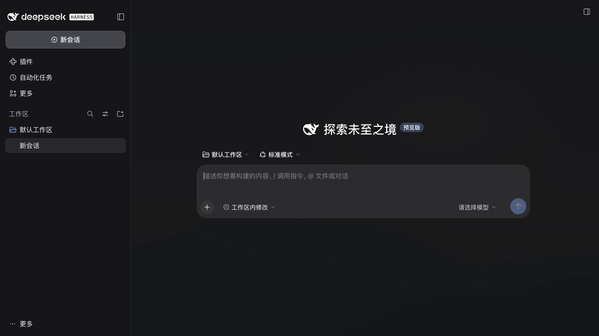
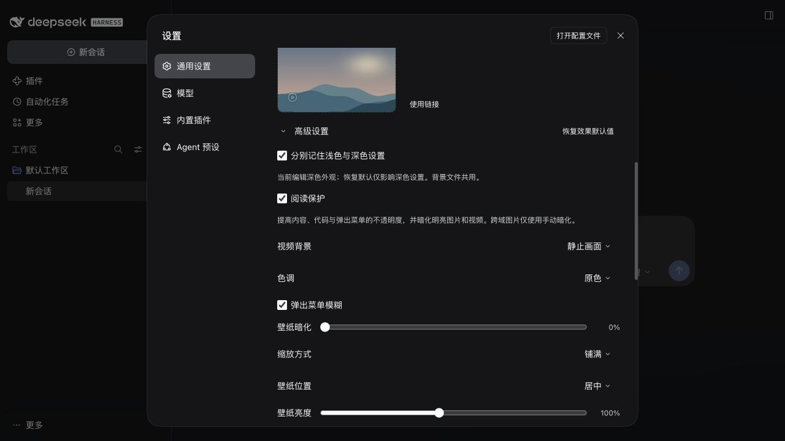

<div align="center">

<h1>液态玻璃</h1>
<p><strong>为 DeepSeek Harness 调整界面通透度，设置图片或视频背景。</strong></p>
<p><code>dsh-liquid-glass</code></p>

<p><strong>简体中文</strong> · <a href="README.md">English</a> · <a href="README.ja.md">日本語</a> · <a href="README.es.md">Español</a> · <a href="README.fr.md">Français</a> · <a href="README.de.md">Deutsch</a> · <a href="README.ru.md">Русский</a> · <a href="README.pt-BR.md">Português (Brasil)</a></p>
<p><a href="CHANGELOG.md">更新日志</a> · <a href="LICENSE">MIT 许可证</a></p>

<p>
  <a href="https://www.npmjs.com/package/dsh-liquid-glass"></a>
  <a href="https://www.npmjs.com/package/dsh-liquid-glass"></a>
  <a href="https://github.com/Ultroncn/dsh-liquid-glass/actions/workflows/ci.yml"></a>
  <a href="docs/v0.4.0-validation.md"></a>
  <a href="LICENSE"></a>
  <a href="https://dsh-insights.com/p/Ultroncn/dsh-liquid-glass/"></a>
</p>

<p><a href="https://awesome-dsh-plugin.com/p/Ultroncn/dsh-liquid-glass/">插件市场</a> · <a href="https://www.npmjs.com/package/dsh-liquid-glass">npm</a> · <a href="https://github.com/Ultroncn/dsh-liquid-glass/releases">版本发布</a> · <a href="https://github.com/Ultroncn/dsh-liquid-glass/issues">反馈问题</a></p>

</div>

为 [DeepSeek Harness](https://github.com/deepseek-ai/deepseek-harness)（DSH）调节界面通透度，设置自己的图片或视频背景。这是一个社区维护的插件。

> **已发布的 npm 0.5.0**包含原版壁纸轮换池和外观设置 JSON 导入、导出。[主分支的更新](https://github.com/Ultroncn/dsh-liquid-glass/pull/30)将轮换移入「背景」，最多 6 个条目单行横向滚动，并移除外观设置导入、导出。这些改动待随新版本发布。

## 安装与打开

在 DSH 插件市场搜索 `dsh-liquid-glass`，核对作者 **Ultroncn** 后安装。使用应用里的「添加插件」输入框时，填写 `dsh-liquid-glass@0.5.0`。

也可以使用命令行。示例使用 `web`，请替换为实际运行 DSH 的 profile。

```sh
dsh plugin --profile web add dsh-liquid-glass@0.5.0 --registry=https://registry.npmjs.org/
```

安装或更新后重启 DSH。打开 **设置 → 通用**，展开「外观」下方的 **主题背景**。总开关同时控制通透效果和图片／视频背景，关闭时保留偏好。

从旧版升级到 0.5.0 时也运行上面的命令。它指定版本并使用 npm 官方源。若遇到 `ERR_PNPM_ADDING_TO_ROOT`，在 `add` 后加 `-w`。

## 使用液态玻璃

1. 选择「标准」「清透」或「磨砂」，再调节界面透明度（3%–95%）。主分支先预览所选预设，可点「应用预设」或「取消预览」。本次会话内可点「撤销预设切换」恢复应用前的外观。
2. 在「背景」中选择本地图片、图片链接或不超过 100 MiB 的本地 MP4／WebM 视频。视频能否解码取决于浏览器。主背景选择器可先预览，再点「保存」。视频静音循环，可手动暂停。
3. 在 0.5.0 中，将已保存的背景添加到「壁纸轮换」。轮换默认关闭，开启后在打开应用时判断是否切换。主分支可在「背景」中点「添加图片」批量选图，点缩略图立即使用，也可逐张替换。「最近使用的图片」保存至多 12 张图片的构图。「拖动调整背景构图」支持拖动、滚轮缩放和键盘可操作的滑块，可预览后保存或取消。
4. 展开「高级设置」可调整浅深色独立外观、阅读保护、色调、菜单模糊、缩放、位置、亮度和暗化。视频可切换为静止画面。「恢复效果默认值」保留背景和总开关。

主分支支持单独关闭「玻璃效果」，保留壁纸并使用宿主原生表面。「恢复原生外观」需要确认，确认后清除当前背景、恢复外观默认值，已添加的轮换壁纸仍可使用。

主分支的「壁纸不透明度」仅控制图片或视频背景。「菜单玻璃模糊」仅作用于宿主菜单和质感预览。

阅读保护默认开启。对话框和浮层保持不透明，内容、代码与菜单至少 94% 不透明，主背景和侧栏仍可调节。它也会暗化明亮的本地或同源媒体，跨域图片不参与自动取样。主分支的高级设置提供独立的自动暗化和边缘暗角滑块，并显示[内容对比度估算](docs/reading-protection-contrast.md)。系统启用减少透明度或增强对比度时，会临时使用磨砂质感，透明度最高 50%。

可用 **Ctrl/Cmd+Shift+G** 切换效果，也可在 DSH「键盘快捷键」中设置「切换液态玻璃」。Linux 网页端默认不绑定，组合冲突时也不自动绑定。

## 界面预览

以下为 0.4.0 在 DSH 0.2.2-rc.2 Web 中的截图。


<details>
<summary>更多截图</summary>





</details>

## 兼容性与数据

插件客户端面向 DSH Web。可查看 [DSH 0.2.2-rc.2 验证记录](docs/v0.4.0-validation.md)、[发布日志](CHANGELOG.md)和[轮换列表更新的 Web 验证](https://github.com/Ultroncn/dsh-liquid-glass/pull/30)。集成细节见[宿主 API 记录](docs/v0.2.0-local-evidence.md)。插件界面提供简体中文和英文。

图片和偏好保存在当前站点的 `localStorage` 中，视频和最近使用的图片记录存放在 IndexedDB。插件没有服务端或遥测功能。

卸载可在同一个 profile 中运行 `dsh plugin --profile web remove dsh-liquid-glass`。需要释放媒体存储时，可先在设置里移除背景。卸载会保留站点本地记录。

## 从源码验证

```sh
npm ci
npm test
npm pack --dry-run --json
```

冒烟测试在模拟的 DSH Web 运行时中运行客户端代码。GitHub CI 使用 Node.js 24。
