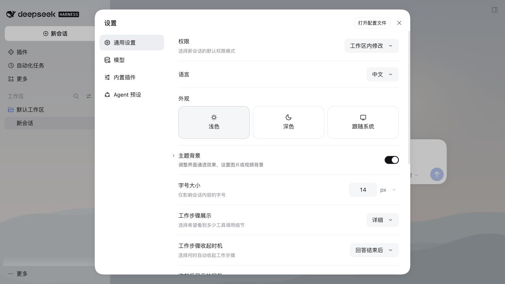
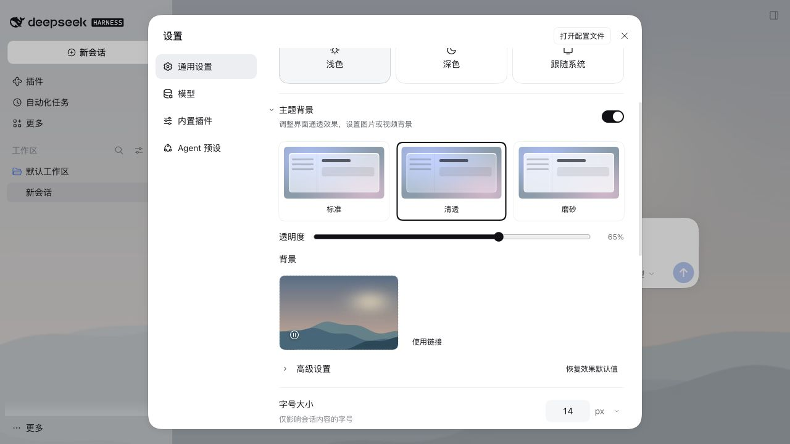
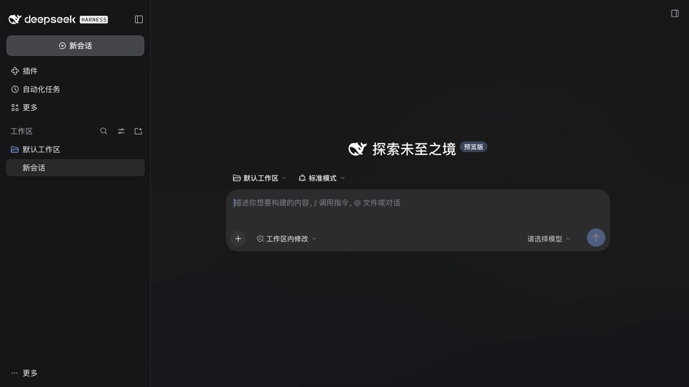
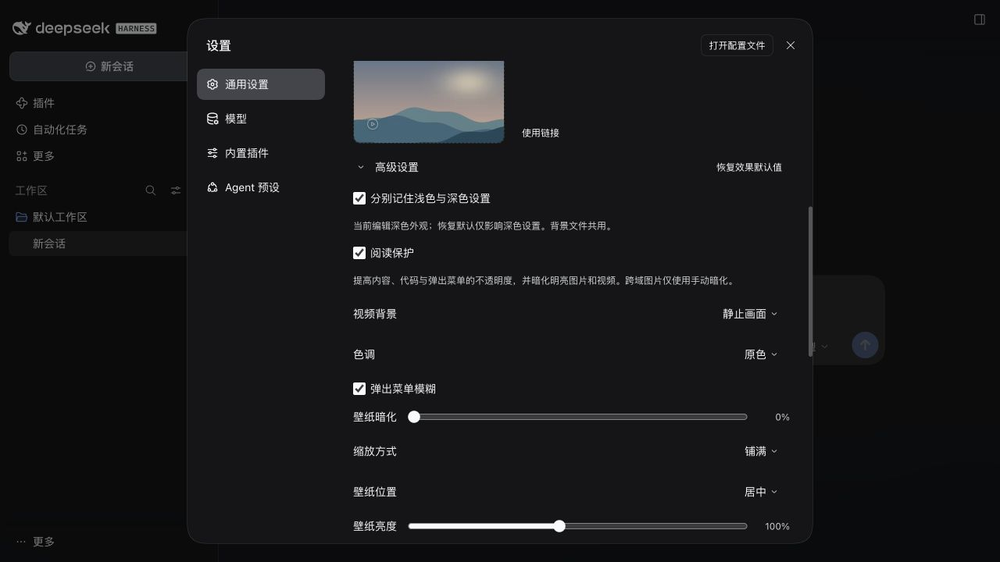

# dsh-liquid-glass

[English](README.md) | 中文

[](https://www.npmjs.com/package/dsh-liquid-glass)
[](LICENSE)
[](https://github.com/deepseek-ai/deepseek-harness)

**[DeepSeek Harness](https://github.com/deepseek-ai/deepseek-harness) 的主题背景插件**：调整界面通透效果，设置图片或视频背景。

通过官方主题接口提供表面透明化、弹出菜单模糊、自定义壁纸、质感预设、色调和系统无障碍响应。当前版本 **0.4.0**。社区插件，界面尽量复用宿主提供的官方组件。

## 安装

```sh
dsh plugin --profile web add dsh-liquid-glass
```

终端中运行上面的命令；如果使用应用的「添加插件」输入框，只填 `dsh-liquid-glass`。

入口为 **设置 → 通用 → 外观下方的「主题背景」**，默认折叠。点击官方箭头展开基础选项；高级选项再次折叠。开关同时控制透明效果和图片／视频背景，关闭不丢失偏好。升级后重启宿主。应用内安装框填写 `dsh-liquid-glass@0.4.0`，不要粘贴完整终端命令。

## 截图

实际安装包在官方 DSH 0.2.2-rc.2 Web 宿主中的截图；背景为本地原创演示素材。开启阅读保护；浅色使用“清透”（65% 透明度），深色使用“磨砂”（22%）与视频静止画面。









## 功能

- **阅读保护**：默认开启；现在让对话框与浮层保持不透明，内容、代码与菜单至少 94% 不透明，主背景和侧边栏继续跟随透明度。高级设置中关闭后恢复原来的全透明风格，并保留原有背景自动暗化功能。
- **浅深色分别记忆**：在高级设置中选用；开启时两套设置都复制当前外观，之后编辑或恢复默认只影响当前浅色／深色方案，跟随系统和自定义主题同样适用。关闭后两种方案都使用当前外观。背景文件和手动暂停状态共用。
- **视频静止画面**：保存视频后，在高级设置中选择“动态播放／静止画面”。静止模式保留当前帧，重新打开时显示首帧；仍保留视频元素，不承诺未经测量的省电或性能收益。

- **统一的设置控件**：复用宿主 Switch、Button、Input、Checkbox、Menu、Modal 和折叠图标。宿主没有公开设置行或滑块组件，相关布局仅作小范围适配，不导入内部样式类。
- **本地视频背景**：选择 MP4／WebM（不超过 100 MiB，需浏览器支持对应编码）验证后立即预览，点击“保存”后写入本地；静音循环，可暂停／播放、移除。页面不可见或系统启用“减少动态效果”时自动暂停。暂不支持视频 URL、声音、播放列表。
- **卡片式选择**：三张质感预览卡片；图片和视频共用常驻上传卡片，支持点击或拖放。更换和红色移除按钮位于缩略图浮层内，不再额外显示文件名或媒体描述。
- **背景草稿**：添加、更换和移除立即预览，点击“保存”才持久化。关闭设置、切换菜单或收起主题背景时，有未保存更改会弹出“保存并离开／放弃更改／继续编辑”；放弃会恢复已保存背景。
- **精简默认界面**：仅展开预设、透明度和背景选择；色调、弹出菜单模糊、背景适配与阅读保护放在高级设置。恢复效果默认值保留背景和总开关。

- **主题表面透明化**：经官方 ThemeRuntime token 覆盖层生效，透明度主滑块范围为 3%–95%。
- **标准、清透、磨砂三档预设**，另有冷白、暖灰、墨色；可用透明度滑块微调。
- **弹出菜单模糊**：可独立关闭；设置卡片使用官方描边色，插件预览面板带内侧高光。宿主原有滤镜作用位置不变。
- **壁纸控制**：铺满／完整显示／拉伸、九个位置、20%–200% 亮度、0%–60% 手动暗化。启用阅读保护时，视频和明亮的本地或同源图片至少暗化 35%；跨域链接只使用手动暗化。静态大图自动压缩，GIF 保留原始数据。
- **系统无障碍响应**：减透明或增强对比度启用时，临时使用磨砂质感并将透明度限制为最高 50%，不覆盖用户保存的偏好。
- **快捷键切换**：经宿主快捷键服务注册 Ctrl/Cmd+Shift+G，在宿主「键盘快捷键」设置中可更改或移除「切换液态玻璃」。Linux 网页端默认不绑定；默认组合冲突时退为未绑定命令。

人／助手独立消息不透明度下限，以及任意宿主面板的磨砂／内侧高光，因缺少已核实的官方扩展接口而未实现。参见[本地 API 证据与验证限制](docs/v0.2.0-local-evidence.md)。本版验证记录见 [0.4.0 验证](docs/v0.4.0-validation.md)。

## 隐私与兼容性

- 偏好和图片保存在当前站点的 `localStorage`，视频 Blob 保存在 IndexedDB 中；不同浏览器或站点不共享，清除站点数据会删除保存的视频；插件没有服务端组件，也不发送遥测数据。
- 主要通过 DeepSeek Harness 的公开客户端运行时、语言、插槽、主题和快捷键 API 集成。宿主暂未公开设置离开拦截接口，未保存提示使用面向 0.2.2-rc.2 设置结构的小范围适配，宿主升级后需回归验证。快捷键绑定由宿主管理，网页端用 localStorage，桌面端用设备本地 keybindings.json。
- 支持亮色和暗色方案。独立外观使用带版本的本地记录，旧设置保留；降级至 0.3.x 会恢复旧版本保存的值。安装后需要重启一次 DSH，以便加载客户端 bundle。

## 从源码验证

冒烟测试会在模拟的 DSH 浏览器运行时中执行实际发布的客户端 bundle，覆盖注册、生命周期、设置、持久化、壁纸控制和滑块边界：

```sh
node test/smoke.test.mjs
```

## 卸载

```sh
dsh plugin --profile web remove dsh-liquid-glass
```

卸载前可在设置中移除背景。卸载插件不会自动清理站点的 localStorage 或 IndexedDB；保留的视频仍占用本地存储。不要为了清理本插件而删除宿主的全部站点数据。

## 许可证

MIT
